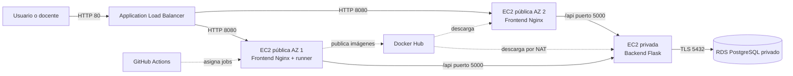

# Arquitectura AWS del entregable

Esta arquitectura implementa en AWS la propuesta del entregable. El diagrama
del PDF es conceptual; en AWS cada subred pertenece a una sola zona de
disponibilidad. Por eso la red pública se materializa como dos subredes y RDS
utiliza dos subredes privadas de base de datos.

## Distribución de red

| Capa | Subred | Zona | Acceso |
|---|---|---|---|
| Frontend 1 + runner | `10.0.0.0/27` | primera AZ de la región | Pública |
| Frontend 2 | `10.0.0.32/27` | segunda AZ de la región | Pública |
| Backend | `10.0.0.64/27` | primera AZ de la región | Privada, salida por NAT |
| RDS 1 | `10.0.0.96/27` | primera AZ de la región | Privada, sin Internet |
| RDS 2 | `10.0.0.128/27` | segunda AZ de la región | Privada, sin Internet |

El VPC completo usa `10.0.0.0/24` en `us-east-1`. El Application Load
Balancer y las dos EC2 frontend están en las subredes públicas. El backend y
RDS no reciben direcciones IP públicas.

## Controles de seguridad

- Internet solamente entra al ALB por el puerto 80.
- El ALB es el único origen autorizado hacia los frontends por el puerto 8080.
- Los frontends son el único origen autorizado hacia Flask por el puerto 5000.
- El backend es el único origen autorizado hacia PostgreSQL por el puerto 5432.
- Ningún grupo de seguridad abre SSH. La administración y los despliegues usan
  AWS Systems Manager.
- Los discos EC2 y el almacenamiento RDS están cifrados.
- RDS genera y rota la credencial inicial mediante Secrets Manager; el backend
  la consulta con su rol IAM y nunca se guarda en GitHub.
- IMDSv2 es obligatorio en las tres instancias.

## Relación con la actividad

- El runner self-hosted vive en la primera EC2 de frontend, no en una cuarta
  instancia.
- CI construye, prueba y publica las tres imágenes con un tag inmutable y
  `latest`, tal como solicita la actividad.
- CD instala el backend y ambos frontends con comandos Docker individuales.
- Un despliegue manual permite indicar un tag anterior para ejecutar rollback.
- La imagen de PostgreSQL se conserva para las pruebas del pipeline; en AWS la
  base de datos permanente es Amazon RDS.

## Consideración de costos

El ALB, NAT Gateway, tres EC2 y RDS generan cargos mientras estén activos. La
plantilla está pensada para crear el laboratorio cuando se vaya a demostrar y
eliminar la pila al terminar. El NAT Gateway suele ser uno de los componentes
con costo fijo por hora más relevante del laboratorio.
